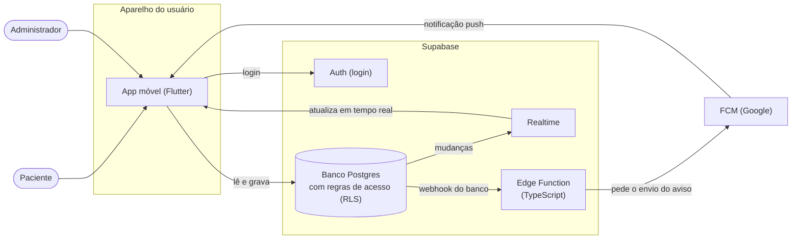
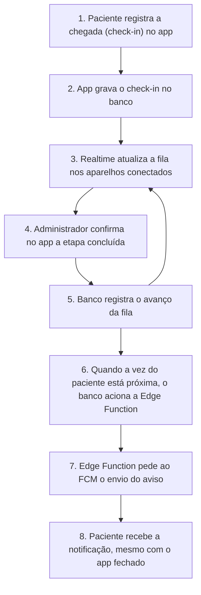

# Arquitetura em componentes e fluxo do check-in à notificação

**Status: Estável.** Vem dos ADRs aceitos (Flutter; Supabase + FCM) e do
projeto oficial (seção 8, resumida no README.md da raiz).

Regras desta pasta: [README.md](README.md).

## 1. Componentes (as peças e quem fala com quem)

| Elemento | Fonte |
|---|---|
| App móvel em Flutter | ADR `2026-11-16-escolha-do-flutter` |
| Supabase: Auth, Postgres com RLS, Realtime | ADR `2026-11-17-backend-banco-push` |
| Edge Function em TypeScript que dispara o push | ADR `2026-11-17-backend-banco-push`, seção Consequências; o disparo por webhook do banco vem do guia oficial citado no ADR |
| FCM entrega a notificação, inclusive com o app fechado | ADR `2026-11-17-backend-banco-push`; projeto oficial |
| Perfis Paciente e Administrador | README.md (resumo do projeto oficial) |

## 2. Fluxo de dados: do check-in à notificação

Segue um dado pelas peças acima, em ordem. Não é o diagrama de sequência da
UML (esse vem depois, no cronograma).

| Passo | Fonte |
|---|---|
| 1 a 3 | Projeto oficial (check-in digital e monitoramento em tempo real); ADR (grava no banco, Realtime) |
| 4 e 5 | Projeto oficial: o administrador "confirma no sistema cada etapa concluída, permitindo o avanço da fila" |
| 6 a 8 | Projeto oficial (aviso quando a vez estiver próxima, com o app fechado); ADR (banco, Edge Function, FCM) |

## Fora deste diagrama (de propósito)

Nada abaixo está decidido, então nada abaixo foi desenhado:

- **Papel do `fila_core`**: o ADR põe a lógica da fila em SQL no Supabase, e o
  `fila_core` é Dart puro. Se ele roda no app ou serve de modelo para o SQL
  não está definido. Está em "Pendências" do MEMORY.md.
- **Quem faz login e como o paciente se identifica.** A seta "login" só diz que
  o app usa o Auth do Supabase.
- **O que significa "vez próxima"** (quantas posições antes de avisar).
- **Conteúdo do aviso**: o projeto prevê etapa e local, mas como o local de
  atendimento é cadastrado não está definido.
- Estimativa de tempo de espera, desistência, início e fim do atendimento,
  senha de atendimento, validação de presença na unidade e push no iOS.
- Limites dos planos gratuitos (estão a reconferir, ver ADR), que não mudam o
  desenho das peças.
