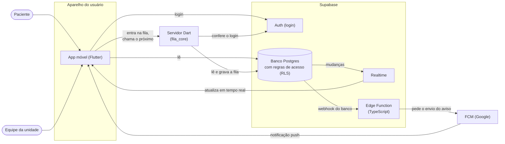
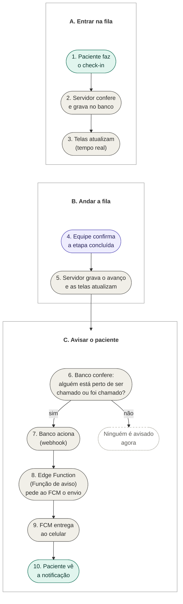

# Arquitetura em componentes e fluxo do check-in à notificação

**Status: Estável.** Vem dos ADRs aceitos (Flutter; Supabase + FCM; servidor
Dart para a lógica da fila) e do projeto oficial (seção 8, resumida no
README.md da raiz).

Regras desta pasta: [README.md](README.md).

## 1. Componentes (as peças e quem fala com quem)

| Elemento | Fonte |
|---|---|
| App móvel em Flutter | ADR `2026-11-16-escolha-do-flutter` |
| Supabase: Auth, Postgres com RLS, Realtime | ADR `2026-11-17-backend-banco-push` |
| Servidor Dart que roda o `fila_core`, lê e grava a fila no Supabase e confere o login | ADR `2026-11-24-servidor-dart-para-a-logica-da-fila`. Onde ele é hospedado e com qual framework não está decidido, e por isso não aparece no desenho |
| Edge Function em TypeScript que dispara o push | ADR `2026-11-17-backend-banco-push`, seção Consequências; o disparo por webhook do banco vem do guia oficial citado no ADR |
| FCM entrega a notificação, inclusive com o app fechado | ADR `2026-11-17-backend-banco-push`; projeto oficial |
| Paciente e equipe da unidade como usuários do app | Projeto oficial (perfis); visita (recepção, triagem e consulta são pessoas e etapas distintas) |

## 2. Fluxo de dados: do check-in à notificação

Segue um dado pelas peças acima, em três caminhos: quem pede (paciente ou
equipe) e o que o sistema faz depois. Não é o diagrama de sequência da UML
(esse vem depois, no cronograma). A cor mostra quem age: paciente (verde),
equipe (roxo) e sistema (cinza).

| Passo | Fonte |
|---|---|
| 1 a 3 | Projeto oficial (check-in digital e monitoramento em tempo real); ADRs (o servidor Dart grava no banco, Realtime) |
| 4 e 5 | Projeto oficial: alguém "confirma no sistema cada etapa concluída, permitindo o avanço da fila"; ADR do servidor Dart (quem avança a fila passa pelo servidor). Quem faz isso não foi visto na visita |
| 6 | Projeto oficial (aviso quando a vez estiver próxima) e RF16 e RF17 (perto de ser chamado; chamado agora). **Hipótese de desenho:** quem faz essa conferência (banco, servidor ou Edge Function) não está decidido |
| 7 a 10 | Projeto oficial (aviso com o app fechado); ADR (banco, Edge Function, FCM) |

Termos do desenho:

- **Servidor confere** (passos 2 e 5): o servidor Dart confere quem está
  pedindo (o login do Supabase), aplica a regra da fila (`fila_core`) e só
  então grava: só deixa o paciente entrar na fila e só deixa a equipe
  avançá-la. As regras de acesso do Supabase (RLS) valem para o que o app lê
  direto do banco.
- **Tempo real** (Realtime): o servidor avisa os aparelhos conectados quando a
  fila muda, sem o app precisar perguntar.
- **Webhook** (passo 7): aviso automático do banco a outro programa quando
  algo acontece.
- **Edge Function** (passo 8, "função de aviso"): pequeno programa na nuvem do
  Supabase, em TypeScript, que só roda quando é acionado. Guarda a chave do FCM
  fora do app.
- **FCM**: serviço do Google que entrega a notificação, mesmo com o app
  fechado.

## Fora deste diagrama (de propósito)

Nada abaixo está decidido, então nada abaixo foi desenhado:

- **Hospedagem e framework do servidor Dart.** O desenho mostra o servidor sem
  dizer onde ele roda nem com qual framework: a equipe ainda vai definir
  (ADR `2026-11-24-servidor-dart-para-a-logica-da-fila`). Há uma proposta
  em discussão, ainda não aceita: ADR `2026-11-27-hospedagem-e-framework-do-servidor-dart`
  (status Proposto).
- **Quem avança a fila.** A visita não mostrou quem opera o painel (pergunta 8
  em `docs/requisitos/requisitos.md`), por isso o desenho diz "equipe da
  unidade". "Administrador" é só quem configura a unidade.
- **Como o paciente se identifica no app.** No guichê a unidade pede nome,
  nascimento ou documento, mas a forma no app segue com a dupla (issue #19). A
  seta "login" só diz que o app usa o Auth do Supabase.
- **O que significa "perto de ser chamado"** (quantas posições antes de avisar,
  RF19) e quem faz essa conferência (passo 6).
- **Como o local de atendimento é informado.** O projeto prevê etapa e local no
  aviso, e na visita o consultório é dito na chamada, mas o cadastro de salas
  segue em aberto (opções A, B e C do `requisitos.md`).
- Estimativa de tempo de espera, desistência, início e fim de cada etapa,
  código de atendimento (RF23), validação de presença na unidade e push no iOS.
- Limites dos planos gratuitos (estão a reconferir, ver ADR), que não mudam o
  desenho das peças.
