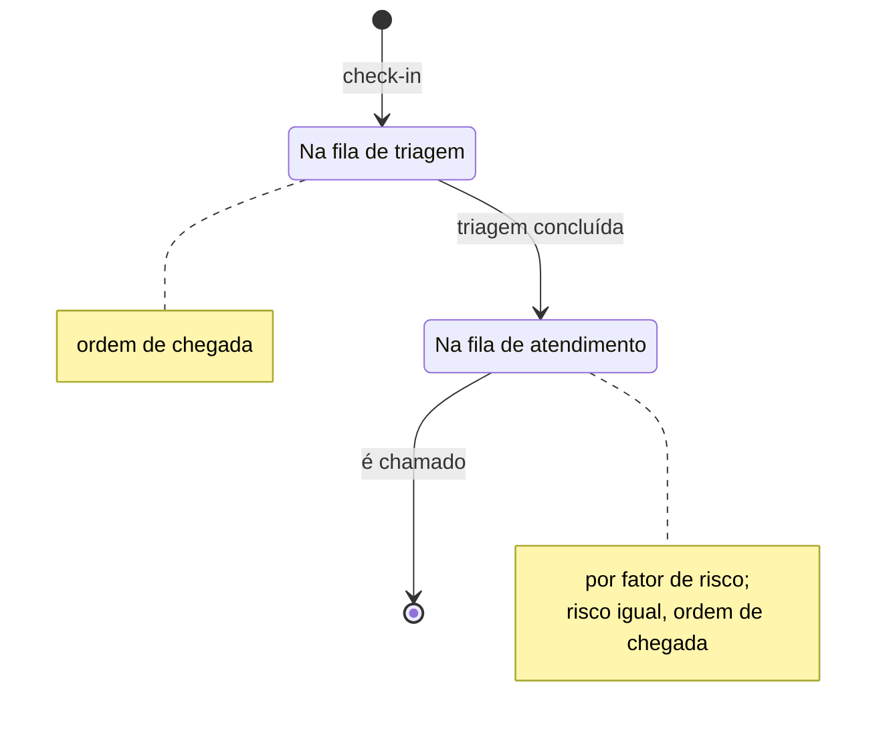

# Estados do paciente na fila

**Status: Provisório.** É o fluxo em duas etapas descrito no projeto oficial
(seção 8, resumida no README.md da raiz). Ele ainda não foi confirmado como o
fluxo real da unidade: revisar depois da análise das visitas de campo.

Regras desta pasta: [README.md](README.md).

| Elemento | Fonte |
|---|---|
| Check-in como entrada | Projeto oficial, funcionalidade 1 |
| Fila de triagem em ordem de chegada | Projeto oficial, funcionalidade 2 |
| Fila de atendimento por fator de risco, empate por chegada | Projeto oficial, funcionalidade 2 |
| "Triagem concluída": o administrador confirma a etapa e a fila avança | Projeto oficial, funcionalidade 1 |

## Relação com o código

Cada fila é uma `Fila` com uma `RegraOrdenacao` (padrão Strategy, em
`app/fila_core`). Hoje só existe a regra de ordem de chegada, que serve à
triagem. A regra por fator de risco ainda não existe no código.

## Fora deste diagrama (de propósito)

Nada abaixo está decidido, então nada abaixo foi desenhado:

- **Quem atribui o fator de risco e qual escala é usada.**
- **O intervalo entre sair da triagem e entrar na segunda fila**, quando a pessoa
  não está em nenhuma fila (a seta "triagem concluída" o resume em um passo), e
  o que vale no empate da segunda fila: a chegada à unidade ou a entrada nela.
- **Quem chama o paciente** em cada etapa.
- Desistência, início e fim do atendimento, local de atendimento, senha,
  prioridade legal (hoje é hipótese no `fila_core`) e estimativa de tempo.
