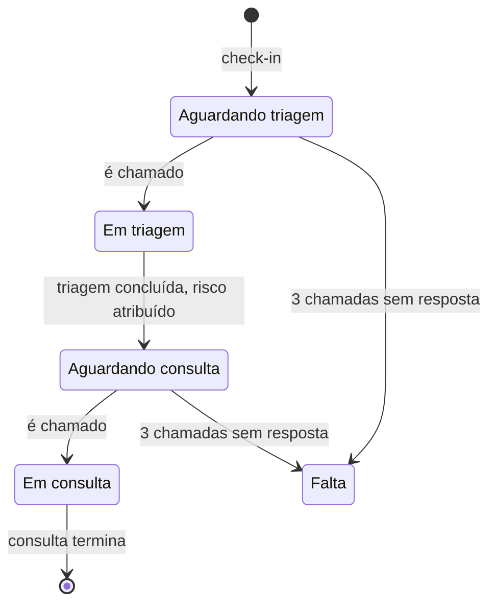

# Estados do paciente na fila

**Status: Provisório.** Os estados vêm do fluxo observado na visita à UPA de
2026-11-19 (uma tarde, uma unidade; não generalizar) e do projeto oficial
(seção 8, resumida no README.md da raiz). Nada foi validado com a unidade.
Revisar se uma nova observação ou a orientadora mudarem o fluxo.

Regras desta pasta: [README.md](README.md).

| Elemento | Fonte |
|---|---|
| Duas etapas de espera, triagem e consulta | Visita (fluxo em 5 linhas); projeto oficial, funcionalidade 2; RF25 |
| Check-in como entrada | Projeto oficial, funcionalidade 1; RF03 |
| "Em triagem" e "Em consulta" | Visita: o paciente passa pela sala de triagem (3 a 8 min nos casos vistos) e pela consulta |
| Risco atribuído ao fim da triagem | Visita: atribuído na triagem, em pulseira colorida (RF15) |
| Chamada para as duas etapas | Visita: a mesma chamada, por voz e TV, serve à triagem e à consulta |
| Falta após 3 chamadas sem resposta | Visita (conferência 5); RF27 |

Os nomes das etapas seguem o RF25. Os estados são os que o paciente vive na
unidade, com ou sem o app.

## Relação com o código

Cada etapa de espera é uma `Fila` com uma `RegraOrdenacao` (padrão Strategy, em
`app/fila_core`). Hoje o núcleo é uma fila só, e a regra por risco não existe;
a evolução para duas etapas é o RF25, que depende de um ADR ainda não escrito.

## Fora deste diagrama (de propósito)

Nada abaixo está decidido, então nada abaixo foi desenhado:

- **A ordem de cada fila.** A visita não confirmou o critério (premissa P3), por
  isso o diagrama não diz "ordem de chegada" nem "por risco".
- **Escala de risco** (premissa P1) e **quem digita o risco no app**.
- **Quem chama o paciente e avança a fila** (pergunta 8).
- **O que acontece depois da falta**: se é definitiva e se a fila anda sem o
  paciente voltar à posição (premissa P5). Por isso "Falta" não tem saída.
- **Como o início e o fim de cada etapa são registrados** (RF24). A unidade não
  registra o fim da consulta.
- Desistência da fila, local de atendimento, código de atendimento (RF23),
  prioridade legal (premissa P3) e estimativa de tempo.
