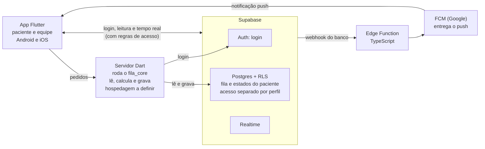

# Fila digital na unidade de saúde: panorama técnico do projeto

> **Rascunho.** Primeira versão, formalizada em 26/11/2026 e ainda em revisão pela dupla: não está 100%. Cópia datada do documento compartilhado; enquanto durar a revisão, as edições são feitas lá e esta cópia é atualizada depois.

Data: 26/11/2026

## Panorama

O projeto é um app de celular para gerir a fila de triagem e de atendimento de uma UPA de Inhumas-GO, para que o paciente veja a posição, uma estimativa de tempo e seja avisado quando for chamado. É uma pesquisa aplicada do PIBIC/IFG, desenvolvida pela dupla Miguel e Heitor em Scrum adaptado, com sprints de cerca de um mês.

**Levantamento bibliográfico.** Foram testadas 8 fórmulas de busca na base Scopus, com apoio de IA, e 5 foram escolhidas (cerca de 7,3 mil documentos). Dos resultados, 40 artigos foram selecionados em quatro eixos: transformação digital, inovação social, empreendedorismo social e inovação em saúde. Em estudos próximos ao app, o autorregistro pelo celular reduziu a espera antes da triagem de 4,4 para 2,9 minutos (Wang et al., 2024).

**Visita à unidade (19/11/2026, uma tarde, 9 pacientes).** O que importa para o desenho do sistema:

- O fluxo tem duas etapas, **triagem e consulta**, numa fila única e mista: a mesma chamada, por voz e TV, serve às duas. A unidade tem 1 guichê, 1 sala de triagem e cerca de 3 consultórios.
- **Não há senha.** O paciente é chamado pelo nome completo; sem resposta a três chamadas, é marcado como falta.
- O risco é atribuído na triagem, em pulseira colorida (vimos verde e amarela). **A unidade não informa o tempo restante** em nenhuma etapa.
- A maior espera foi entre triagem e consulta (pelo menos 36 min em dois casos). O gargalo não está confirmado.
- O critério real de ordem não ficou claro. O que a observação não mostrou virou sete **premissas** (P1 a P7), ainda não validadas com a unidade.

Detalhes em [2026-11-19-visita-upa-sintese.md](2026-11-19-visita-upa-sintese.md) e em [requisitos.md](../requisitos/requisitos.md).

## Arquitetura

O app pede ao servidor Dart para entrar na fila e chamar o próximo, e fala direto com o Supabase para login, leitura e atualização em tempo real, sempre sob as regras de acesso (RLS). O servidor confere o login no Supabase, lê os pacientes que esperam, calcula a ordem com o `fila_core` e grava o resultado. O push nasce de uma mudança no banco: um webhook aciona a Edge Function, que envia a notificação pelo FCM, inclusive com o app fechado.

O desenho vem dos ADRs aceitos. Onde o servidor Dart é hospedado e com qual framework não aparece, porque ainda não foi decidido.

## O que está implementado

Hoje existe um único módulo de código de produção: o **`fila_core`** (`app/fila_core`), um pacote Dart puro, sem Flutter, rede ou banco (RNF08), mergeado no PR #8. Ele contém o mecanismo da fila e a regra de ordem como peça trocável (padrão Strategy).

| Peça | Papel |
|---|---|
| `Paciente`, `TipoPrioridade` | Dados de quem está na fila: id, nome fictício, chegada e prioridade (`nenhuma`, `legal`, `legal80`) |
| `RegraOrdenacao` | Contrato "quem vem antes?", que a `Fila` consulta |
| `RegraOrdemDeChegada` | A regra mais simples |
| `RegraPrioridadeLegal` | Regra provisória: 80+, depois prioridade legal, depois os demais, com desempate por chegada. **É hipótese**: vem da legislação, não de documento da unidade, e não considera risco clínico |
| `Fila` | `entrar`, `chamarProximo`, `posicaoDe`, `tamanho`, `estaVazia`, `pacientesEmOrdem` |

**Convenções internas já decididas e travadas por testes** (PR #22): a ordem é calculada na hora, e não mantida na lista; o desempate usa um contador de entrada que nunca se repete; ausência esperada devolve `null` e contrato violado lança `ArgumentError`; a posição começa em 1; `pacientesEmOrdem` é um retrato em cópia; a `Fila` só usa o `id` do paciente. Em uma medição única com 2.000 pacientes, esvaziar a fila levou cerca de 520 ms antes da otimização e 26 ms depois.

**Em aberto no núcleo:** a unicidade do `id` vale só entre quem espera (quem foi chamado pode reentrar) e não existe operação de desistência (RF12). Também não existem ainda a regra por risco, a mudança de etapa, a falta (RF27), a estimativa de espera nem o registro de início e fim das etapas (RF24).

**Testes.** `dart test` na pasta do pacote roda 18 testes da fila, com nomes em português e dados fictícios, mais os da regra de prioridade legal; `dart analyze` cobre a análise estática.

**O que ainda não existe:** telas (há só um spike web descartável na branch `spike/flutter-basico`), o servidor Dart, o esquema do banco, as notificações e a integração contínua. O app ainda não foi validado em Android.

## Decisões de arquitetura (ADRs)

Quatro decisões estão registradas como ADR no repositório. As duas mais recentes (26/11/2026) foram aprovadas pelo Miguel nos próprios PRs, ainda abertos, e aguardam a revisão do Heitor; a ordem de merge prevista é #27, #26 e #28.

| ADR | Decisão | Situação |
|---|---|---|
| Escolha do Flutter | App móvel em Flutter (Dart), Android e iOS | Aceito (PR #4, 17/11). O spike foi só web; Android não validado |
| Backend, banco e push (#7) | Supabase (Postgres, Auth, Realtime, RLS) para banco, login e tempo real; FCM para push, disparado por webhook do banco e Edge Function em TypeScript. Descartados Firebase (NoSQL, sem Cloud Functions no plano grátis) e backend próprio em FastAPI | Aceito (PR #7 e #17, 18/11). O trecho "sem servidor próprio" foi revisto pelo #27 |
| Servidor Dart para a lógica da fila (#27) | O `fila_core` roda num servidor Dart próprio, que a cada pedido lê o Supabase, monta a `Fila`, calcula e grava. O servidor não guarda a fila na memória. Supabase segue com banco, login, RLS e tempo real | Aceito em 26/11 (PR #27, rascunho). **Hospedagem e framework a definir pela equipe** |
| Etapas e estados do paciente (#26) | Registro único por paciente (uma tabela) com cinco estados: aguardando triagem, em triagem, aguardando consulta, em consulta e falta. Uma `Fila` por etapa: triagem por chegada e consulta por risco, com desempate por chegada | Aceito em 26/11 (PR #26). **As duas regras de ordem são hipótese (P3)** |

O #27 avaliou cinco alternativas sobre onde roda o código que decide a ordem: no app (A), na regra em SQL no banco (B), descartar o `fila_core` (C), dividir entre banco e Dart (D) e servidor Dart próprio (E). Escolheu a E, e a D virou o desenho interno dela. O motivo declarado foi manter a regra, que é o centro da pesquisa, em Dart e testável sem banco, numa linguagem só nos dois lados. O custo é hospedar um servidor, proteger a chave de administrador do Supabase e validar o login do usuário.

O PR #28 (rascunho) é só documentação: atualiza AGENTS.md, app/README, modelagem, requisitos e MEMORY.md para refletir o #27 e o #26.

## Modelo de dados e estratégia de testes

**Modelo de dados.** O #26 define a forma (um registro por paciente com o estado, e uma `Fila` por etapa montada a partir dele), mas o esquema das tabelas ainda não foi desenhado. Os requisitos já indicam o que ele precisará cobrir:

| O modelo precisa guardar | Origem |
|---|---|
| Estado do paciente (cinco estados) e a etapa em que espera | ADR #26; RF25 |
| Ordem de chegada e código de atendimento anônimo, no lugar do nome | RF23; RNF10 |
| Risco atribuído na triagem, em escala configurável (padrão: cinco cores) | RF15; premissa P1 |
| Condição de prioridade legal informada pelo paciente | RF04 |
| Início e fim de cada etapa, para medir a duração real | RF24; RF13 |
| Consultório da chamada e número de chamadas sem resposta (padrão 3, configurável) | RF26; RF27 |
| Vínculo com o login do paciente e token FCM do aparelho | RF01; ADR de backend |
| Caminho para excluir os dados do paciente | RNF02 |

As regras de acesso (RLS) e os diagramas de classes e sequência também não existem; o cronograma os prevê para jan/2027, e o escopo do UML depende de resposta da orientação (issue #13).

**Testes.** O que existe são testes unitários do núcleo, em Dart puro e com dados fictícios, que também servem como especificação: cada convenção do algoritmo está travada por um teste. O cronograma prevê, no Sprint 4, testes dos fluxos principais (RF20 e RF21) e a validação em Android e iOS (RF22). Ainda não foi definido como testar o servidor Dart contra o Supabase, as regras de acesso, a Edge Function e o envio do push dentro do plano gratuito, nem como automatizar a execução.

## Próximos passos

1. Revisar e mesclar os PRs #27, #26 e #28, nessa ordem.
2. Escolher hospedagem e framework do servidor Dart, com um experimento curto antes.
3. Evoluir o núcleo: regra por risco, mudança de etapa, falta, desistência e registro de início e fim das etapas.
4. Desenhar o esquema do banco a partir dos estados do #26.
5. Validar o app em Android e criar a primeira tela real (Sprint 1, check-in digital, a partir de mar/2027).
6. Reconferir os limites do plano gratuito do Supabase e os termos de dados (LGPD) antes de qualquer dado real.

## Dúvidas técnicas em aberto

A maioria das dúvidas já está registrada nos ADRs, nos requisitos ou nas issues. As dúvidas 5 e 6 são perguntas que o desenho levanta e que a dupla ainda não discutiu.

| # | Dúvida | Contexto |
|---|---|---|
| 1 | Qual hospedagem usar para o servidor Dart: Render gratuito ou Cloud Run? | O Render dorme após 15 min parado e leva cerca de 1 min para acordar, e não tem região no Brasil (a confirmar). O Cloud Run tem São Paulo, mas exige cartão de cobrança, e o projeto é de custo zero. Empacotar em Docker facilita trocar depois |
| 2 | Qual framework: Dart Frog, Serverpod ou Shelf? | O Serverpod traz banco e login próprios, o que conflita com manter essas partes no Supabase. A ideia é fazer um experimento curto antes de escolher |
| 3 | Como limitar os riscos do servidor que escreve com a chave `service_role`? | Essa chave ignora a RLS, então a segurança de escrita passa a depender do código Dart. O servidor também precisa validar o token que o Supabase deu ao usuário |
| 4 | Quem dispara o aviso de "vez próxima": o banco, o servidor ou a Edge Function? | O Supabase conseguir chamar um servidor externo por webhook não foi verificado na documentação. Hoje o desenho só prevê o push disparado pelo banco |
| 5 | Estado atual num registro único ou também um histórico de transições? | O RF24 e a estimativa de espera (RF13) precisam das durações reais; guardar início e fim em cada registro basta ou um histórico de eventos é mais seguro? |
| 6 | Como evitar conflito quando dois pedidos chegam juntos? | O servidor lê a fila, calcula e grava a cada pedido, sem guardar estado em memória. Duas pessoas chamando o próximo ao mesmo tempo podem escolher o mesmo paciente. Transação ou bloqueio de linha resolvem? |
| 7 | Como compor risco, prioridade legal e chegada em uma só `RegraOrdenacao`, mantendo-a trocável? A estimativa de espera fica junto da regra ou separada? | A combinação real na unidade é desconhecida (premissa P3). O núcleo hoje só tem chegada e prioridade legal, sem risco clínico |
| 8 | `chamarProximo` e o início do atendimento são o mesmo passo? | Hoje o núcleo tira o paciente da fila ao chamar, e o RF27 prevê três chamadas antes da falta. Depende de quem opera o painel (não visto na visita). Resolver também se um mesmo `id` pode reentrar na fila |
| 9 | O login gov.br é viável com o Supabase Auth? | Exige credencial do sistema junto ao governo, que o IFG teria de pedir (issue #19). A alternativa é cadastro próprio com dados fictícios ou login anônimo com código |
| 10 | Como testar servidor, regras de acesso, Edge Function e push sem ambiente pago, e o que automatizar na integração contínua? | O plano gratuito do Supabase pausa após 1 semana sem uso, e o push no iOS exige conta paga da Apple (cerca de US$ 99 por ano, a confirmar); sem ela, o push só é validado no Android |
| 11 | Que escopo mínimo de UML (casos de uso, classes e sequência) basta para um MVP em Scrum adaptado? | O cronograma prevê os três diagramas para jan/2027, e a dupla propõe reduzir o escopo (issue #13), já que o núcleo da fila foi adiantado |
